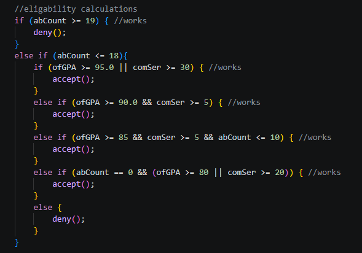
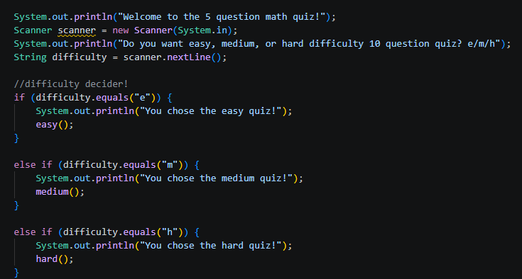

# HACKCLUB PLEASE READ
**When I first shipped the project, I didn't realize that you could make only one project per week (google lied to me). 
Because of this, I shipped the project after 4 hours with only one program, thinking I would make a second and third for the remaining hours.
However, I realized I couldn't do this, so instead I added two additional programs into this ship. Because of this, the description written inside of terra and the demo link are incorrect... along with the name of the project. So, please refer to this readme for the correct/combined information about my project.... sorry for the noob mistake.**

Also, Im not sure if this stuff all counts as part of the challange but I think it should since it is all java programs I wrote.

To see information on each of my projects, click the dropdown to expand the section.... (it looks a little bit neater).

# What is this?

This is a set of threeprograms written inside of java that can be viewed, edited, and run via the website (linked below). Originally it started out as a single program, but I finished that one quickly so I decided to add two others that are part of the same package. 

# How-To-Play
To view and run my projects go to this website:
https://sites.google.com/view/escapeislandjavaterra/home

Once you open the website you are greeted with a page which has buttons taking you to all of the programs for this project. When you go to a program page, you will see that the program is embedded into the page and ready to run. Simply press the the red button in order to start the program, and interact through console. (See image bellow)

### All Programs (click to view)
Click on one of the programs in this project to view details and a summary for the program.

  
Escape the Island

  ## Escape The Island

  This is a choose your own adventure style game created in java and runs entirely in the terminal.
The point of this game is to try and escape an island you are trapped on...based on the choices that you make from the prompts given to you. You must make your way through the house you start in, outside through the wilderness, through a maze, and even through a locked secret door in order to try and escape.... can you survive and make it back to your apartment in the city, or will they catch you?

## Images
This is some of the game art that I made for this project:

  
Honor Cord Calculator

   ## Honor Cord Calculator

  This is a calculator that allows you to find out if you are able to earn an honor cord at my school. 
You are judged on your GPA, absences, and community service hours.
This is the criteria you must meet to be eligble:
+ Students who have been absent for more than 18 days are not eligible for an honor cord no matter what else is true.
+ Students who have a 95% overall grade or completed 30 hours of community service above are eligible to receive an honor cord.
+ Students who have a 90% overall grade or above and completed 5 hours of community service are eligible to receive an honor cord.
+ Students who have an 85% overall grade or above and completed 10 hours of community service and only missed a maximum of 10 days are eligible for an honor cord.
+ Students who have perfect attendance and either have a 80% overall grade or completed 20 hours of community service are eligible for an honor cord.
+ All other cases would mean the student is not eligible for an honor cord.

These one is pretty straightforward since it mainly uses lots of if statements and scanners in order to collect the user/students statistics

## Images
**This is the if statement responsible for all of the qualifying.**

### Sample students

I made a few sample students and their stories:

----------

**Name: Thomas Tanker**

Overall Grade: 68.7     Absences: 12     Community Service Hours: 35 

**Student Profile:**
Thomas tanker is a student who is not super book smart, but he likes helping others. Because of this, he spends a lot of time playing football and volunteering at the food bank, helping feed the people who are struggling in his community. Sometimes he misses school because of football injury, but for the most part he tries his best to be attentive and present at school. 

**Name: John Steak**

Overall Grade: 98.9     Absences: 0     Community Service Hours: 2

**Student Profile:**
John Steak only cares about 2 things, his GPA and his perfect attendance record. Because of this, he rarely does anything fun, let alone any community service, but he makes sure that he is always getting A+ on his assignments and that he never misses a day of school… even when he is sick!!

**Name: Frank Furt**

Overall Grade: 85.7     Absences: 9     Community Service Hours: 15

**Student Profile:**
Frank Furt is your average, run of the mill student. He may not wow anyone with his attendance or his GPA, but both are respectable, as well as the amount of time he dedicates to his community with a respectable 15 hours of community service at the senior center. He may not be outstanding, but he is definitely reliable.

  
5 Question Math Quiz

## 5 Question Math Quiz

This is a set of 3, 5 question math quizzes, each with a different difficulty. 
The **easy** quiz only involves addition and subtraction. The **medium** quiz adds mutliplication and division. The **hard** quiz adds exponents, fractions, triangles, and percentages. 

Want to know how you did... Dont worry!     You are given a score out of 5 for the quiz you take!

Like the other programs, this one uses a lot of if statements, and a lot of scanners... since it is based in the terminal...(duhhhh).
The most difficult part of this whole project was definitely thinking of all the math problems, since im not very good at math... (I have a C+ in AP Calc right now).

## Images

The only image I have for this program is the selection purpose for when you choose which quiz you want to take.

### Last notes

This was by far the most technically easy program to write since a lot of the code was repeating and just values changed, but it was still one of the more time consuming since I had to create math problems (see lapse) and also find solutions... for all three quizzes.

## Closing Remarks

This project was very fun for me to complete since all of these programs were things that I wanted to make, so being able to get credit for Terra was a huge bonus. This was a massive undertaking for me since I completed all 10 hrs of code in only one weekend, since I had so much schoolwork during the week. I learned a surprisingly large amount about Java and VsCode, since both were not unfamiliar but also not veteran tools for me. **These projects definitely are not perfect or complete... and I am sure there is bugs... if you have any suggestions/comments/fixes feel free to email me at: masonbbbsmith@gmail.com**